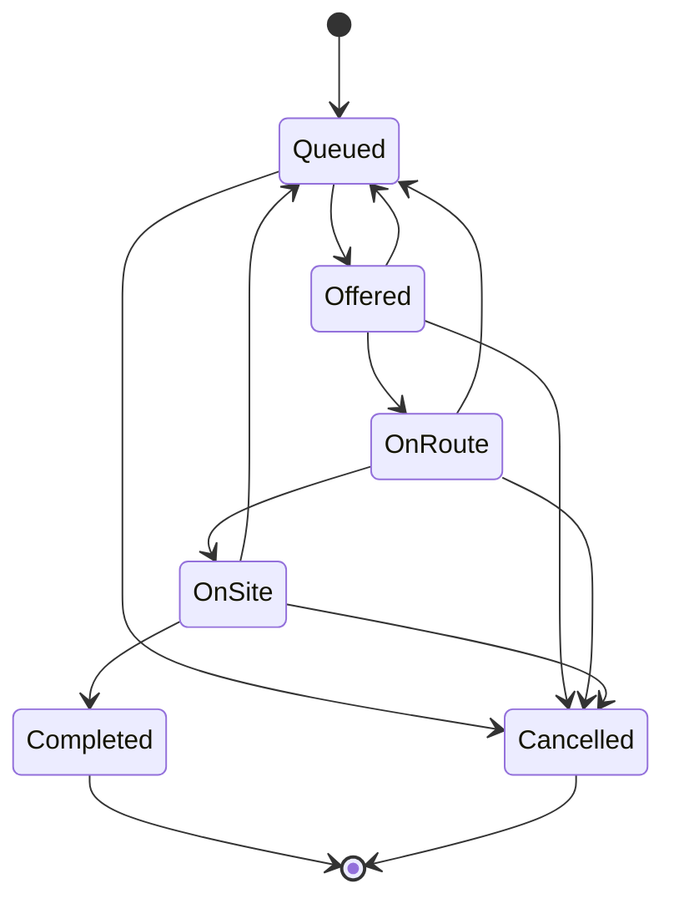
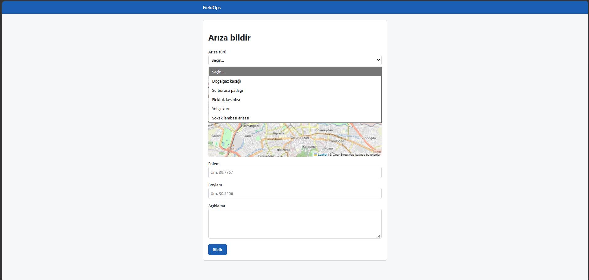
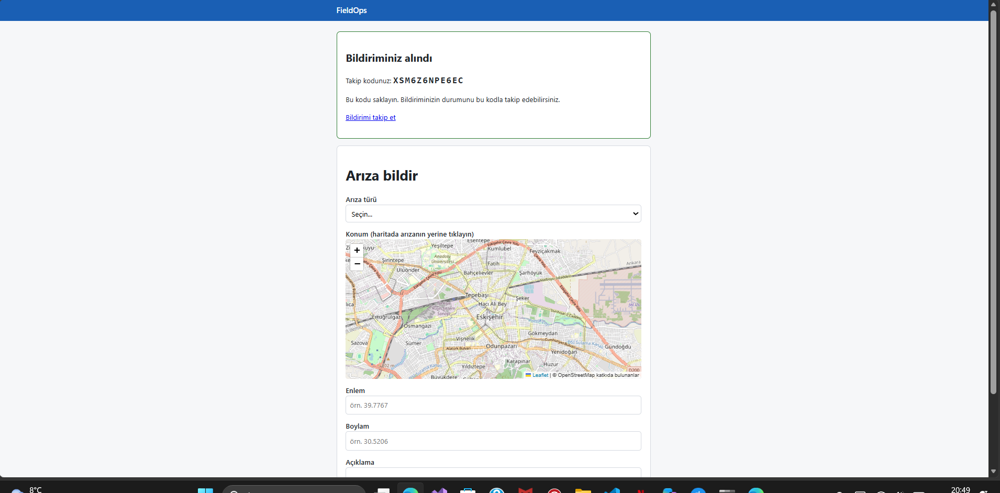
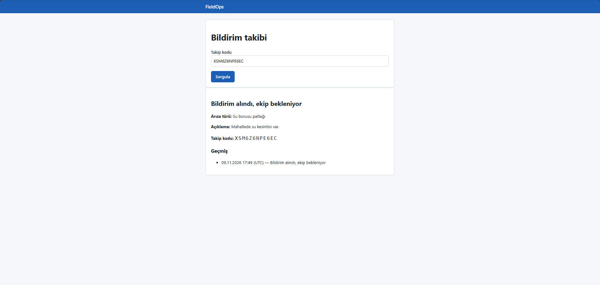
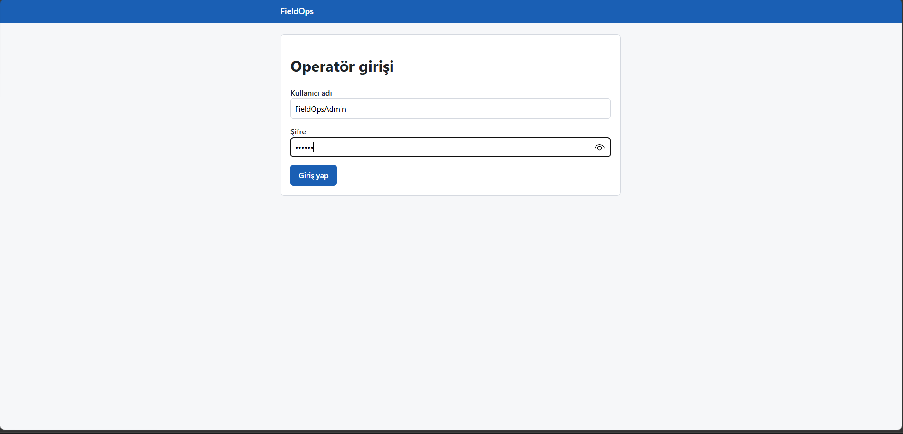
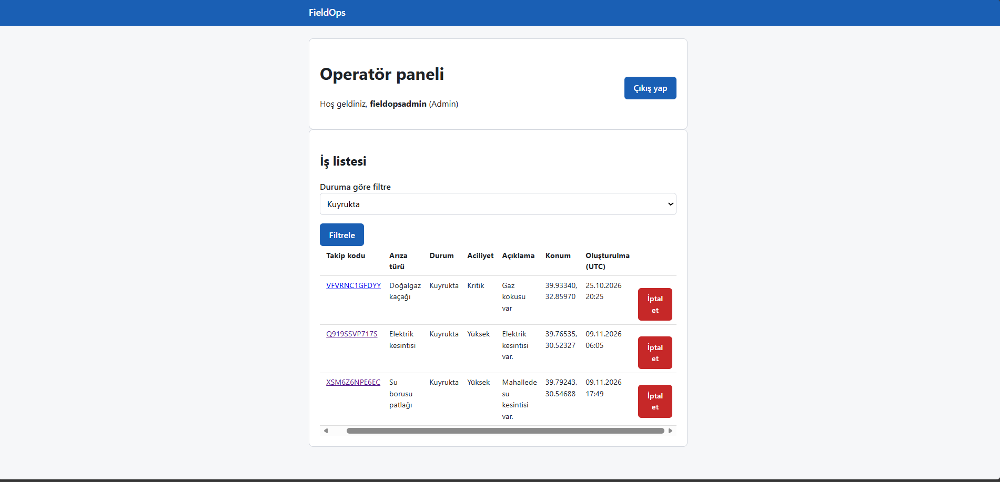
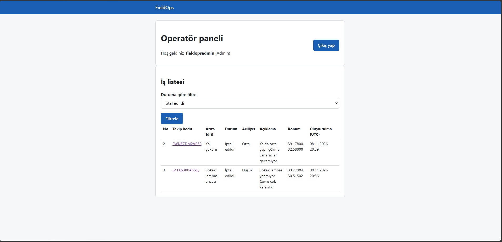

# FieldOps

Şehir altyapı arızaları için otomatik ekip atama sistemi.
**Teknolojiler:** C# / .NET 10 · ASP.NET Core (API + Razor Pages) · PostgreSQL + PostGIS · EF Core · JWT · xUnit · Docker · GitHub Actions

---

## 1. Ay: Yapılanlar

**Ay sonu hedefi:** Bildirim oluşturulup iş olarak izlenebiliyor.
**Durum:** Vatandaş arıza bildirir, sistem bunu bir **iş** olarak kaydeder, vatandaş takip kodu ile durumu izler, operatör işi panelden görür.

### Plandaki işler ve durumları

### Plandaki işler

| Planlanan iş                      | Ne yapıldı                                                                                    | Kodda nerede                      |
| --------------------------------- | --------------------------------------------------------------------------------------------- | --------------------------------- |
| Veri modeli ve veritabanı         | 5 tablo, PostGIS konum alanı, 3 migration, örnek veri                                         | `Domain/`, `Data/`, `Migrations/` |
| Arıza bildirimi                   | Bildirim oluşturma + takip koduyla sorgulama (API ve sayfa)                                   | `Reports/`, `Tracking/`           |
| İş kaydı ve durum yönetimi        | Her bildirim bir iş olur; durum geçiş kuralları, durum geçmişi, eşzamanlı değişiklik koruması | `Domain/Job*.cs`, `Jobs/`         |
| Temel rol bazlı giriş             | JWT ile API girişi, çerez ile panel girişi, 3 rol, yönetici kullanıcı oluşturma               | `Auth/`, `Users/`                 |
| Vatandaş bildirim ve takip ekranı | Haritadan konum seçerek bildirim formu, takip sayfası                                         | `Pages/Report`, `Pages/Track`     |
| Ek: Operatör paneli               | İş listesi, duruma göre filtre, iş iptali                                                     | `Pages/Operator`                  |

### Akış: Bir bildirim nasıl iş olur?

1. Vatandaş **Arıza bildir** sayfasında arıza türünü seçer, haritaya tıklayarak konumu işaretler ve açıklama yazar.
2. Sistem girilen bilgileri doğrular ve bildirimi **iş** olarak kaydeder. İşin durumu `Queued` (Kuyrukta) olur. Aciliyet, arıza türünün varsayılan aciliyetinden alınır.
3. İlk durum kaydı **durum geçmişine** yazılır.
4. Vatandaşa **12 karakterlik takip kodu** verilir.
5. Vatandaş **Bildirim takibi** sayfasına kodu girer ve işin güncel durumunu ile geçmişini görür.
6. Operatör giriş yapar, **Operatör paneli**nde işleri aciliyete göre sıralı görür, duruma göre filtreler, gerekirse işi iptal eder. İptal de durum geçmişine yazılır.

### Veri modeli

PostgreSQL + PostGIS üzerinde 5 tablo vardır. İlişkiler: `fault_types.required_skill_id → skills`, `jobs.fault_type_id → fault_types`, `job_status_histories.job_id → jobs`.

**`skills` (Beceri):** ekiplerin sahip olabileceği uzmanlık alanı.

| Alan | Açıklama |
|---|---|
| `id` | Birincil anahtar |
| `name` | Benzersiz. Örnek veri: Gas, Plumbing, Electrical, RoadWork |

**`fault_types` (Arıza türü):** hangi arıza için hangi beceri gerekir.

| Alan | Açıklama |
|---|---|
| `id`, `name` | Birincil anahtar, benzersiz ad |
| `required_skill_id` | Arızayı çözmek için gereken beceri (`skills`) |
| `estimated_duration_minutes` | Tahmini süre (dakika) |
| `default_urgency` | Varsayılan aciliyet |

Örnek veri (migration ile yüklenir):

| Arıza türü | Gereken beceri | Süre | Aciliyet |
|---|---|---|---|
| Gas leak (Doğalgaz kaçağı) | Gas | 90 dk | Critical |
| Burst water pipe (Su borusu patlağı) | Plumbing | 120 dk | High |
| Power outage (Elektrik kesintisi) | Electrical | 90 dk | High |
| Pothole (Yol çukuru) | RoadWork | 60 dk | Medium |
| Street light failure (Sokak lambası arızası) | Electrical | 30 dk | Low |

**`jobs` (İş):** her bildirim bir iştir. Her job içib bir skill gerekir.

| Alan | Açıklama |
|---|---|
| `id` | Birincil anahtar |
| `fault_type_id` | Arıza türü |
| `location` | Konum: `geography(point, 4326)`, yani PostGIS nokta (GPS koordinatı) |
| `description` | Açıklama, en fazla 2000 karakter |
| `initial_urgency` / `urgency` | İlk aciliyet / güncel aciliyet. Ay 2'de aciliyet zamanla artırılacağı için ikisi ayrı tutuldu |
| `status` | İş durumu (metin olarak saklanır) |
| `tracking_code` | Takip kodu, benzersiz |
| `created_at` | Oluşturulma zamanı |
| `version` | Eşzamanlılık sürümü (aşağıya bakın) |

**`job_status_histories` (Durum geçmişi):** işin geçtiği her durum bir satır olarak saklanır.

| Alan | Açıklama |
|---|---|
| `job_id` | Hangi iş |
| `old_status` / `new_status` | Önceki durum (ilk kayıtta boş) / yeni durum |
| `changed_at` | Değişiklik zamanı |

**`users` (Kullanıcı):**

| Alan | Açıklama |
|---|---|
| `user_name` | Benzersiz, küçük harfe çevrilerek saklanır |
| `password_hash` | Şifre düz metin değil, hash olarak saklanır |
| `role` | `Team`, `Operator` veya `Admin` |
| `is_active` | Pasif kullanıcı giriş yapamaz |
| `created_at` | Oluşturulma zamanı |

**Önemli tasarım kararları**
- **Konum PostGIS ile saklanır.** Ay 2-4'te "en yakın ekip" ve mesafe hesapları doğrudan veritabanında yapılabilecek.
- **Durumlar metin olarak saklanır** (`Queued`, `OnRoute` gibi). Veritabanına bakınca okunabilir.
- **Eşzamanlılık koruması:** `jobs.version` alanı (PostgreSQL `xmin`) sayesinde iki kişi aynı işi aynı anda değiştirirse ikincisi hata alır ve veri sessizce ezilmez. Bu, Ay 3'teki çift atama korumasının temelidir.
- **Durum geçmişi silinmez**, her değişiklik yeni satır olarak eklenir.

### İş durumları ve geçiş kuralları

Durum geçişleri kodda tek yerde (`JobStatusTransitions`) tanımlıdır. İzin verilmeyen geçiş yapılamaz.



| Durum | Anlamı |
|---|---|
| `Queued` | Kuyrukta, ekip bekliyor |
| `Offered` | Ekibe teklif edildi |
| `OnRoute` | Ekip yolda |
| `OnSite` | Ekip sahada |
| `Completed` | Tamamlandı |
| `Cancelled` | İptal edildi |


### İş Durumu Geçişleri

| Durum Geçişi | İşlemi Gerçekleştiren | Açıklama |
| ------------ | -------------------- | -------- |
| Kuyrukta → Teklifte | Atama motoru (sistem) | İşin bir ekibe teklif edilmesi |
| Teklifte → Yolda | Ekip | Ekibin işi kabul etmesi |
| Yolda → İşte | Ekip | Ekibin arıza konumuna ulaşması |
| İşte → Tamamlandı | Ekip | İşin tamamlanması |
| Herhangi bir durum → İptal | Operatör | İşin operatör tarafından iptal edilmesi |
| Teklifte / Yolda / İşte → Kuyrukta | Sistem veya ekip | Teklifin reddedilmesi, süre aşımı veya ekibin işi bırakması |


Ay 1'de **operatör yalnızca işi iptal edebilir**. Teklif, ekip durumları ve tamamlama akışı Ay 3'te eklenecek. Geçiş kuralları şimdiden hazır ve test edildi.

### Roller

| Rol | Yetki (Ay 1) |
|---|---|
| Vatandaş (giriş yok) | Bildirim oluşturur, takip koduyla durumu görür |
| `Operator` | Panele girer, işleri listeler, işi iptal eder |
| `Admin` | Operatör yetkileri + yeni kullanıcı oluşturur |
| `Team` | Rol tanımlı, ekip ekranları Ay 3'te |

### Ekranlar ve API

**Sayfalar:** `/` ana sayfa · `/Report` arıza bildir · `/Track` bildirim takibi · `/Login` operatör girişi · `/Operator` operatör paneli

**API uçları:**

| Uç | Yetki | Görevi |
|---|---|---|
| `POST /api/reports` | Herkese açık | Bildirim oluşturur, takip kodu döner |
| `GET /api/reports/{takipKodu}` | Herkese açık | Durum ve geçmişi döner |
| `POST /api/auth/login` | Herkese açık | JWT döner |
| `GET /api/auth/me` | Giriş yapmış | Kullanıcı adı ve rol |
| `POST /api/users` | Admin | Kullanıcı oluşturur |
| `GET /api/operator/jobs?status=&limit=` | Operator, Admin | İş listesi (aciliyet, sonra eski olan önce) |
| `PATCH /api/operator/jobs/{id}/status` | Operator, Admin | Durum değiştirir (Ay 1'de yalnızca `Cancelled`) |

**Güvenlik ve doğrulama**
- Şifreler hash'lenir. Kullanıcı yoksa da şifre kontrolü yapılır (kullanıcı adı tahmin saldırısını zorlaştırır).
- JWT anahtarı kodda değil, kullanıcı gizli anahtarlarında (user secrets) tutulur. En az 32 bayt değilse uygulama açılmaz.
- Bildirim alanları (arıza türü, koordinat aralığı, açıklama uzunluğu) sunucuda doğrulanır.
- Takip kodu 12 karakterdir, karışan harfler (I, L, O, U) kullanılmaz. Kod çakışırsa sistem 3 kereye kadar yeni kod üretir.

### Test ve otomasyon

- **125 test metodu** (xUnit): durum geçişleri, takip kodu, doğrulama, giriş/JWT, kullanıcı yönetimi, operatör uçları, sayfalar.
- **Gerçek veritabanı testleri:** Testcontainers ile PostGIS container'ı ayağa kalkar, migration'lar çalışır; konum kaydı, örnek veri ve eşzamanlılık çakışması gerçek PostgreSQL üzerinde test edilir.
- **CI:** Her push ve pull request'te GitHub Actions projeyi derler ve testleri çalıştırır (`.github/workflows/ci.yml`).

### Ekran görüntüleri

**1. Arıza bildirim formu** (arıza türü seçimi, haritadan konum)


**2. Bildirim alındı, takip kodu verildi**


**3. Takip kodu ile durum sorgulama**


**4. Operatör girişi**


**5. Operatör paneli: kuyruktaki işler aciliyete göre sıralı, "İptal et" düğmesiyle**


**6. Duruma göre filtre (iptal edilen işler)**


---

## Kurulum ve Çalıştırma

Gereksinimler: .NET 10 SDK, Docker.

```bash
cp .env.example .env                       # POSTGRES_PASSWORD değerini değiştirin
docker compose up -d                       # PostGIS veritabanı (localhost:5433)

cd src/FieldOps.Api
dotnet user-secrets set "ConnectionStrings:Default" "Host=localhost;Port=5433;Database=fieldops;Username=fieldops;Password=<.env'deki şifre>"
dotnet user-secrets set "Jwt:Key" "<en az 32 karakterlik rastgele metin>"
dotnet user-secrets set "Seed:AdminUsername" "admin"
dotnet user-secrets set "Seed:AdminPassword" "<şifre>"

dotnet tool restore && dotnet ef database update   # tabloları oluşturur
dotnet run                                         # http://localhost:5197
```

Testler (Docker açık olmalı): `dotnet test`

---

## 2-6. Ay Planı

| Ay | Yapılacak çalışma | Ay sonunda beklenen çıktı |
|---|---|---|
| 1 | Veri modeli ve veritabanı; arıza bildirimi, iş kaydı ve durum yönetimi; temel rol bazlı giriş; vatandaş bildirim ve takip ekranı | Bildirim oluşturulup iş olarak izlenebiliyor  |
| 2 | Ekip ve vardiya verisi; eleme kuralları; puanlama fonksiyonu ve karar gerekçesi kaydı; dinamik önceliklendirme | Bir iş için gerekçeli ekip seçimi çalışıyor |
| 3 | Bekleme kuyruğu; teklif, kabul, ret, zaman aşımı ve tamamlama akışı; eşzamanlılık koruması; ekip ve operatör ekranları | Uçtan uca atama ve çift atama koruması hazır (1. öncelik tamam) |
| 4 | Simülatör ve senaryolar; ölçüm altyapısı; en yakın ekip yöntemi; ilk deneme koşuları; eşzamanlılık testleri | Senaryolar çalışıyor, ilk karşılaştırma sonuçları var |
| 5 | Tam deney koşuları (5 tekrar); ağırlık ayarı; performans testleri; tablo ve grafiklerin hazırlanması | Tüm deney sonuçları ve grafikler hazır |
| 6 | Sonuçların değerlendirilmesi ve tartışma; hata düzeltme; rapor yazımı ve sunum hazırlığı. Zaman kalırsa 3. öncelikten bir özellik | Rapor, sunum ve tekrar üretilebilir deney paketi (2. öncelik tamam) |
